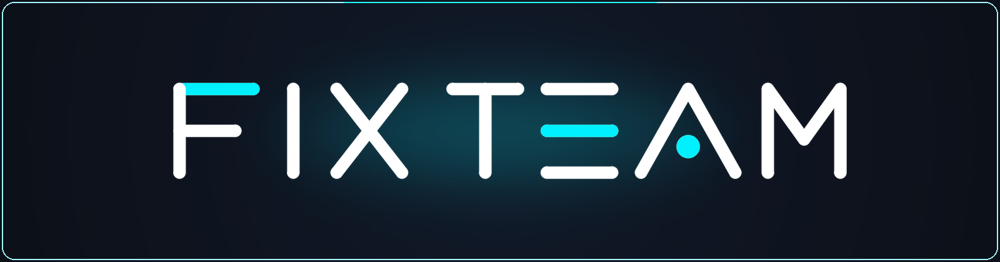
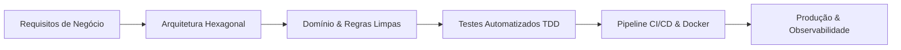

  <a href="https://fixteam.uk" target="_blank">
    <picture>
      <source media="(prefers-color-scheme: dark)" srcset="./assets/banner.png">
      <source media="(prefers-color-scheme: light)" srcset="./assets/banner.png">
      
    </picture>
  </a>

  # ⚡ FixTeam
  ### **Engenharia de Software · RPAs Críticos · IA Aplicada & OCR · Plataformas Web**

  

    
    
    
    
  

  

    <i>Transformando desafios operacionais e regras de negócio complexas em ecossistemas digitais escaláveis, resilientes e de alta performance.</i>
  

   

  

 

## 💡 Sobre Nós

A **FixTeam** é especializada em engenharia de software de ponta a ponta e desenvolvimento de soluções digitais de alto impacto. Atuamos desde a modelagem de backends de missão crítica, conciliação financeira e esteiras de inteligência artificial local até automações robóticas de alto volume (RPA) e interfaces web modernas de alta conversão.

Nossos projetos combinam **disciplina arquitetural**, **concorrência assíncrona**, **segurança multi-tenant** e **design refinado**, garantindo entregas robustas prontas para produção corporativa.

---

## 🎯 Pilares de Atuação

<table>
  <tr>
    <td width="50%" valign="top">
      <h3>⚡ Engenharia de Backend & APIs</h3>
      <ul>
        <li><b>Arquitetura Hexagonal & Clean Architecture:</b> Isolamento rígido de domínios, Ports & Adapters e manutenibilidade.</li>
        <li><b>Isolamento Multi-Tenant:</b> Estratégia <i>Schema-per-Tenant</i> em PostgreSQL com controle granular de RBAC.</li>
        <li><b>Streaming & Mensageria:</b> Eventos em tempo real via <b>SSE (Server-Sent Events)</b>, WebSockets e Redis Pub/Sub.</li>
        <li><b>Conciliação & Ledgers:</b> Motores financeiros com idempotência, auto-balance e auditoria contínua.</li>
      </ul>
    </td>
    <td width="50%" valign="top">
      <h3>🤖 RPAs Críticos & Web Scraping</h3>
      <ul>
        <li><b>Robôs de Alta Velocidade:</b> Disputa de pregões eletrônicos e cotações em tempo real com <b>HTTP/2</b> e <b>Playwright</b>.</li>
        <li><b>Automações Complexas:</b> Validação e preenchimento consular multi-etapas (DS-160) e bots corporativos.</li>
        <li><b>Bypass & Resiliência:</b> Tratamento adaptativo de rate limits, CAPTCHA v2/v3 e retries exponenciais com <i>Stamina</i>.</li>
        <li><b>Escalabilidade:</b> Orquestração de dezenas de instâncias simultâneas via <b>Celery</b> e <b>AsyncIO</b>.</li>
      </ul>
    </td>
  </tr>
  <tr>
    <td width="50%" valign="top">
      <h3>🧠 IA Aplicada, OCR & Extração</h3>
      <ul>
        <li><b>OCR Híbrido & Inteligente:</b> Processamento com <b>Docling (PyTorch)</b> local em CPU com fallback para IA em nuvem.</li>
        <li><b>Busca Semântica Local:</b> Inferência vetorial com <b>FastEmbed (ONNX)</b> direta no servidor sem custos abusivos de API.</li>
        <li><b>Regras De-Para & Classificação:</b> Triagem de extratos fiscais/bancários com categorização dinâmica e exportação ERP.</li>
      </ul>
    </td>
    <td width="50%" valign="top">
      <h3>🌐 Plataformas Web & Landing Pages</h3>
      <ul>
        <li><b>Next.js, React & Tailwind CSS:</b> Interfaces ultra-rápidas, responsivas e otimizadas para SEO e conversão.</li>
        <li><b>Dashboards & Painéis em Tempo Real:</b> Visualização interativa de métricas, telemetria e conferência de dados.</li>
        <li><b>Design System Consistente:</b> Experiência de usuário premium com micro-animações e acessibilidade.</li>
      </ul>
    </td>
  </tr>
</table>

---

## 📂 Nossos Projetos & Soluções em Destaque

 

### 📊 **1. G2 Extratos Bancários — Suite de Extração & IA Contábil**
> **Solução corporativa para triagem, extração em lote e conciliação contábil automatizada.**
- **Pipeline em Lote:** Ingestão de pacotes ZIP e múltiplos PDFs de extratos bancários com processamento assíncrono.
- **Motor OCR Híbrido:** Extração de tabelas e textos via **Docling (PyTorch CPU)** não-bloqueante com controle de semáforos e fallback de LLM.
- **Conferência & De-Para:** Interface interativa de conferência lado a lado (Ctrl+Clique no PDF), drag-and-drop de lançamentos e exportação nativa para o sistema **Questor Contábil**.
- **Tecnologias:** `Python` · `Docling` · `FastAPI` · `Mistral AI` · `DuckDB` · `PostgreSQL`

---

### 🏛️ **2. Licitize — Plataforma de Disputa & Pregões Eletrônicos**
> **Plataforma corporativa de alto impacto para captura de editais e envio de lances em tempo real.**
- **Multi-Portais:** Integração e monitoramento contínuo em portais públicos (*ComprasGov*, *PNCP*, *BLL*, *BNC*, *LicitaNet*).
- **Disputa em Milissegundos:** Execução ultra-rápida via conexões HTTP/2 (`httpx`), retries com `Stamina` e bypass inteligente com `Playwright`.
- **Estratégias Adaptativas:** Modos de disputa automatizados (DE, PA, PAF), agendamento via `APScheduler` e resolução de desafios CAPTCHA.
- **Tecnologias:** `Python` · `Playwright` · `HTTP/2` · `FastAPI` · `Redis` · `Docker`

---

### 💳 **3. Ledger Financeiro & Contabilidade Multi-Tenant**
> **Backend white-label para registro contábil, liquidação fiat/crypto e conciliação de ledgers.**
- **Isolamento Total:** Arquitetura Hexagonal com *Schema-per-Tenant* (PostgreSQL 16) identificado dinamicamente por header `X-Tenant-ID`.
- **Tempo Real & Auditoria:** Transmissão de eventos de caixa via **SSE (Server-Sent Events)** com Redis Pub/Sub e auditoria detalhada via ELK Stack.
- **Qualidade Assegurada:** Cobertura abrangente com suíte de dezenas de testes automatizados (`Pytest`).
- **Tecnologias:** `Python (FastAPI)` · `SQLAlchemy 2.0 Async` · `PostgreSQL` · `Redis` · `Docker`

---

### 🚀 **4. FixTeam Projects & Plataformas Web (`new_project`)**
> **Novas plataformas digitais, dashboards analíticos e ecossistemas SaaS desenvolvidos pela FixTeam.**
- **Experiência Full Stack:** Backends modernos integrados a interfaces ricas, reativas e com telemetria ao vivo.
- **Alta Disponibilidade:** Ambientes conteinerizados com Docker, deploys automatizados via CI/CD e suporte a múltiplos bancos de dados.
- **Tecnologias:** `Next.js` · `React` · `Node.js` · `Fastify` · `Tailwind CSS` · `Prisma / SQLAlchemy`

---

## 🛠️ Stack Tecnológica & Ferramentas

### 💻 Linguagens & Core

  
  
  
  
  
  
  

### ⚙️ Backend, APIs & Mensageria

  
  
  
  
  
  
  

### 🤖 IA, OCR & Automação (RPA)

  
  
  
  
  
  

### 🗄️ Bancos de Dados & Armazenamento

  
  
  
  
  
  

### 🎨 Frontend & Interfaces Web

  
  
  
  
  

### ☁️ DevOps, Nuvem & Qualidade

  
  
  
  
  
  

---

## ⚙️ Padrões de Engenharia & Qualidade

- **🧪 Testes de Ponta a Ponta:** Cobertura de testes unitários e de integração para regras de negócio críticas.
- **🔒 Segurança & Isolamento:** Criptografia de ponta a ponta, autenticação segura (JWT, TOTP, RBAC) e isolamento estrito de dados.
- **📈 Observabilidade Ativa:** Monitoramento de logs, métricas de performance e alertas para garantir alta disponibilidade.
- **⚡ Entrega Contínua (CI/CD):** Pipelines automatizados para build, validação estática (`Ruff`, linters) e deploy sem downtime.

---

## 👤 Engenharia & Liderança Técnica

   
  <a href="https://github.com/Isaac-Foster">
     
     
    <h3><b>Isack Vitor (@Isaac-Foster)</b></h3>
  </a>
  
<b>Lead Backend Engineer · Arquiteto de Software · Engenheiro de RPAs & IA</b>

  
<i>Especialista em microsserviços em Python, conciliação de ledgers financeiros, esteiras de OCR/IA local e automações de missão crítica.</i>

  

    
    &nbsp;
    
    &nbsp;
    
    &nbsp;
    
  

   

---

## 🤝 Vamos Construir Algo Incrível Juntos?

Seja para automatizar processos críticos, criar motores de OCR e IA sob medida, integrar sistemas financeiros ou desenvolver plataformas web modernas e escaláveis, nossa equipe está pronta para atender seu projeto.

   

  
  &nbsp;
  
  &nbsp;
  

    

  
© 2026 <b>FixTeam</b> — Transformando ideias em soluções digitais de alto impacto.

